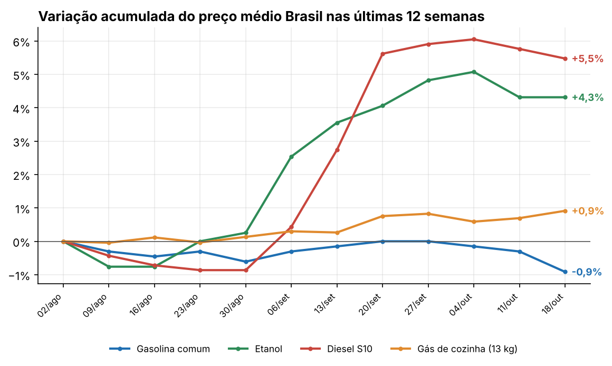
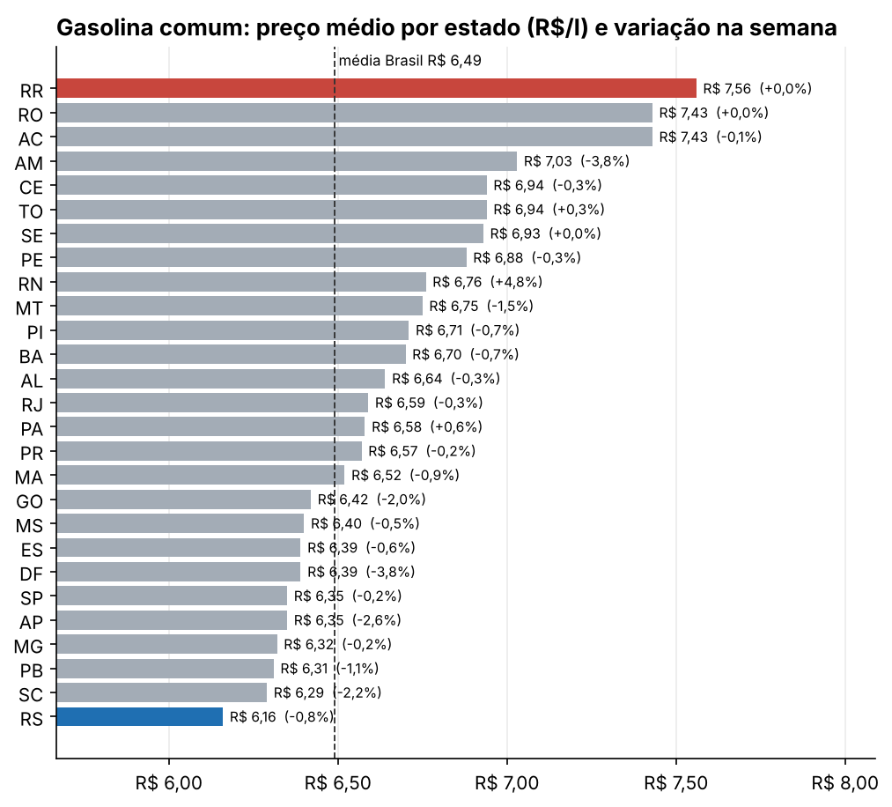

# Relatório automático de preços de combustíveis

Toda segunda-feira, este repositório baixa os dados mais recentes da ANP, calcula os indicadores da semana e publica um relatório pronto em **Excel e PDF**, com gráficos e um resumo executivo. Ninguém precisa abrir uma planilha.

**[Ver o relatório mais recente](reports/ultimo/RESUMO.md)** · [PDF](reports/ultimo/relatorio.pdf) · [Excel](reports/ultimo/relatorio.xlsx)



## O problema

A ANP publica toda semana o levantamento de preços de combustíveis de cerca de 4.600 postos. Montar um acompanhamento à mão envolve:

1. entrar no site, achar o arquivo da semana e baixar (o nome do arquivo muda de padrão de uma semana para outra);
2. abrir a planilha, achar onde começa a tabela, filtrar produtos e estados;
3. juntar com as semanas anteriores para calcular variação;
4. refazer gráficos, montar o PDF e escrever o resumo.

Fazendo isso à mão, estimo umas 2 horas por semana. **Aqui roda sozinho em menos de um minuto**, sempre no mesmo padrão e sem erro de copiar e colar.

## O que o relatório traz

| Indicador | Por que importa |
|---|---|
| Preço médio Brasil de gasolina, etanol, diesel S10 e gás de cozinha | Visão geral da semana |
| Variação na semana e nas últimas 12 semanas | Mostra tendência, não só a foto do dia |
| Ranking de gasolina por estado, com a variação semanal | Onde está mais caro/barato e onde mexeu |
| Paridade etanol/gasolina por estado | O etanol compensa quando custa até 70% da gasolina |
| Resumo executivo em texto | Para quem tem 30 segundos |

Exemplo da semana de 18/10/2026 (dados reais da ANP):

> A gasolina comum caiu na semana: média nacional de R$ 6,49/l (-0,6%), -0,9% em 12 semanas. Maior alta em 12 semanas: Diesel S10 (+5,5%), hoje a R$ 7,32/l. Gasolina mais barata em RS (R$ 6,16) e mais cara em RR (R$ 7,56), diferença de R$ 1,40 por litro. Maior alta semanal da gasolina: RN (+4,8%). O etanol compensa (até 70% do preço da gasolina) em 12 estados; a melhor relação é em MT (60%).

<p float="left">
  
  
</p>

## Como funciona

```
GitHub Actions (toda segunda 09h)
   └─ coleta.py      lê a página da ANP e baixa os resumos das últimas 12 semanas
   └─ leitura.py     encontra a tabela em cada planilha e padroniza as colunas
   └─ indicadores.py variações, ranking por estado e paridade etanol/gasolina
   └─ resumo.py      resumo em texto (regras ou IA, ver abaixo)
   └─ graficos.py    3 gráficos em PNG
   └─ relatorio.py   Excel formatado + PDF + RESUMO.md
   └─ commit automático em reports/<semana>/ e reports/ultimo/
```

Alguns detalhes que deram trabalho:

- **Nome dos arquivos sem padrão.** A ANP alterna entre `resumo_semanal_lpc_2026_10_18-2026_10_24.xlsx` e `resumo_semanal_lpc_2026-10-04_2026-10-10.xlsx`. Em vez de montar a URL, o script lê os links da própria página.
- **Tabela começa no meio da planilha.** Tem umas 9 linhas de título antes do cabeçalho. A leitura procura a linha "DATA INICIAL" em vez de fixar a linha 10, então continua funcionando se a ANP mexer no título.
- **Site do governo oscila.** O download tenta de novo até 3 vezes antes de falhar.

### Resumo com IA (opcional)

Se o repositório tiver o secret `ANTHROPIC_API_KEY`, o resumo é escrito por um modelo de IA usando **só os números calculados**. O prompt proíbe inventar dados ou causas. Sem a chave, ou se a chamada falhar, o resumo é montado por regras. O relatório nunca deixa de sair por causa da IA.

Para ligar: *Settings → Secrets and variables → Actions → New repository secret*, com nome `ANTHROPIC_API_KEY`.

## Rodando localmente

```bash
pip install -r requirements.txt
python main.py            # baixa da ANP e gera o relatório da semana
python main.py --offline  # usa a amostra em tests/fixtures (12 semanas reais, sem internet)
pytest -q                 # 10 testes
```

Os testes usam uma amostra de 12 semanas reais (ago a out/2026) recriada no mesmo layout das planilhas da ANP, e cobrem leitura, cálculo dos indicadores, fallback da IA e o pipeline completo.

## Estrutura

```
├── main.py                       # orquestra tudo
├── src/
│   ├── coleta.py                 # download dos resumos semanais
│   ├── leitura.py                # leitura e padronização das planilhas
│   ├── indicadores.py            # cálculos
│   ├── resumo.py                 # resumo por regras ou IA
│   ├── graficos.py
│   └── relatorio.py              # Excel, PDF e Markdown
├── tests/                        # pytest + amostra real
├── reports/                      # um relatório por semana (gerado pelo Actions)
└── .github/workflows/relatorio-semanal.yml
```

## Ferramentas

Python (pandas, openpyxl, matplotlib, fpdf2) · GitHub Actions · pytest · API de IA (opcional)

---

Dados: [ANP, Levantamento de Preços de Combustíveis](https://www.gov.br/anp/pt-br/assuntos/precos-e-defesa-da-concorrencia/precos/levantamento-de-precos-de-combustiveis-ultimas-semanas-pesquisadas).

**Luiz Arioza** · [LinkedIn](https://www.linkedin.com/in/luizarioza/) · [outro projeto: análise de e-commerce](https://github.com/LuizArioza/analise-ecommerce-olist)
