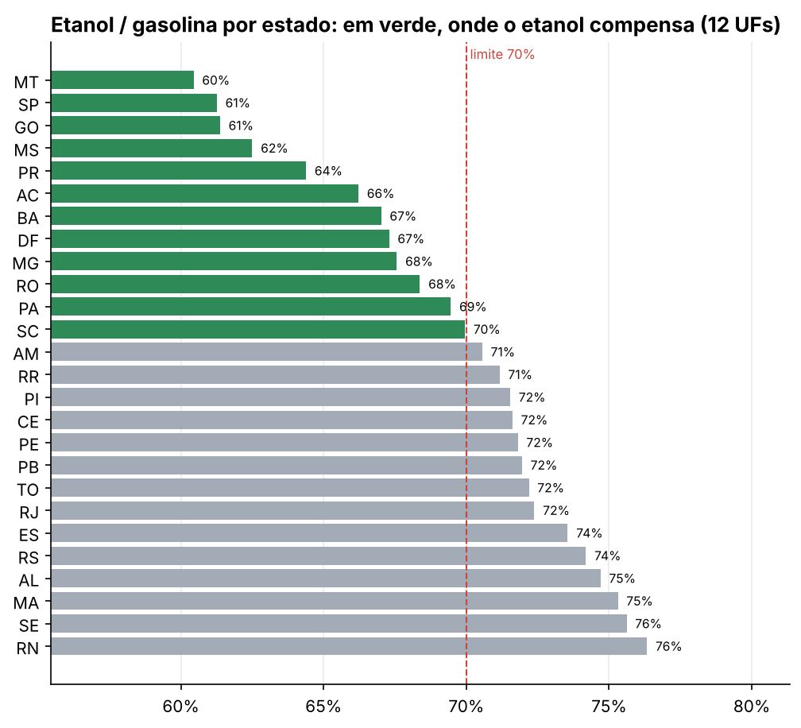

# Combustíveis: semana de 18/10/2026

> A gasolina comum caiu na semana: média nacional de R$ 6,49/l (-0,6%), -0,9% em 12 semanas. Maior alta em 12 semanas: Diesel S10 (+5,5%), hoje a R$ 7,32/l. Gasolina mais barata em RS (R$ 6,16) e mais cara em RR (R$ 7,56), diferença de R$ 1,40 por litro. Maior alta semanal da gasolina: RN (+4,8%). O etanol compensa (até 70% do preço da gasolina) em 12 estados; a melhor relação é em MT (60%).

Resumo gerado automaticamente a partir dos indicadores.

| Produto | Preço médio | Var. semana | Var. 12 semanas |
|---|---:|---:|---:|
| Gasolina comum | R$ 6,49/l | -0,6% | -0,9% |
| Etanol | R$ 4,11/l | +0,0% | +4,3% |
| Diesel S10 | R$ 7,32/l | -0,3% | +5,5% |
| Gás de cozinha (13 kg) | R$ 114,98/13kg | +0,2% | +0,9% |

